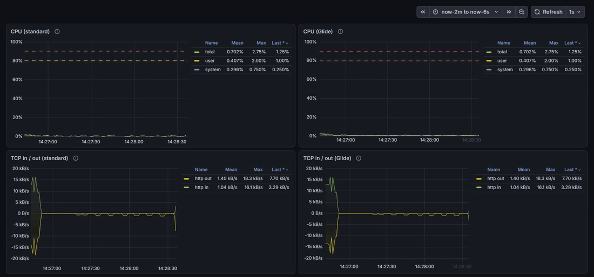

# Glide time series

Migrating off Netdata made me miss smooth gliding panels. This plugin (bobby-glide-panel) brings that to Grafana 13, keeping the time axis scrolling continuously so new data slides in seamlessly instead of the whole chart jumping on every refresh.



Glide looks and behaves like Grafana's built-in **Time series** panel: same legend, tooltip, axes,
colours and shared crosshair, and the same field option names. Changing a panel's `"type"` in the
dashboard JSON between `timeseries` and `bobby-glide-panel` keeps every setting, which is also
the rollback path. The plugin is frontend only and makes no network requests.

## Getting started

Requires Node 24.5+ and Docker.

```bash
npm install
npm run build
docker compose up -d --build
```

This starts Grafana 13.3.1 on http://localhost:3000 (signed in as admin) with `dist/` mounted as
the plugin, plus a VictoriaMetrics instance that scrapes itself every second. The test dashboard
at http://localhost:3000/d/glide-local shows each built-in panel next to its Glide twin.

Grafana loads plugins at startup, so run `docker compose restart grafana` after the first build
or any change to `src/plugin.json`. Other rebuilds only need a browser reload.

Tests: `npm run test:ci` runs the unit tests. The end to end tests need the stack running and a
Playwright browser, installed once with `npx playwright install chromium`; then run `npm run e2e`.

## Installing

The plugin is unsigned, so Grafana has to allow it:

1. Copy `dist/` to `<grafana plugins dir>/bobby-glide-panel`.
2. Set `GF_PLUGINS_ALLOW_LOADING_UNSIGNED_PLUGINS=bobby-glide-panel`.
3. Restart Grafana.

[deploy/README.md](deploy/README.md) has the full production procedure, including rollback.

## How it works

`src/engine/` draws on a canvas with its own frame loop; `src/components/` is the React shell
(legend, tooltip, Grafana events); `src/data/` turns query results into series. The contract
between engine and shell is `src/engine/api.ts`.

- **Gliding.** The visible window is placed from wall-clock time, so it moves at exactly real time
  and resumes correctly after a hidden tab. It trails "now" by a small lag sized from how late
  data usually arrives, so the line reaches the right edge between refreshes. When the lag has to
  change, the window speeds up or slows down by a few percent instead of jumping. Absolute
  ranges, ranges longer than the "Longest animated range" option, and panels with Glide off are
  drawn statically.
- **Refreshes.** Late data is drawn in progressively instead of popping in, revised values blend
  over 300 ms, and the last result stays on screen while a query loads.
- **Grafana parity.** The y range and tick steps are ports of the uPlot logic Grafana uses, so
  axes match the built-in panel exactly, including binary steps for byte units and percent
  stacking.
- **Crosshair.** Glide joins the same uPlot sync channel as the built-in panels through a hidden
  uPlot chart (`UPlotSyncBridge.tsx`), so crosshairs move smoothly in both directions and other
  panels never mistake it for a mouse hover. Crosshairs arriving from sources that update less
  often are eased between updates.
- **Cost.** Frames are skipped while the chart moves less than 0.2 device pixels, dense series
  keep only the extremes of each pixel column, and the loop pauses for hidden tabs and panels
  scrolled out of view.

## Development

Scaffolded with Grafana's `create-plugin`; the rules for working on it, documentation links and
e2e conventions are in [.config/AGENTS/instructions.md](.config/AGENTS/instructions.md) and
[.config/AGENTS/e2e-testing.md](.config/AGENTS/e2e-testing.md). In short: leave `.config/`
untouched, keep the plugin id and type, and restart Grafana after editing `src/plugin.json`.

Disclaimer: This was created with the assistance of AI for end-to-end validation.
